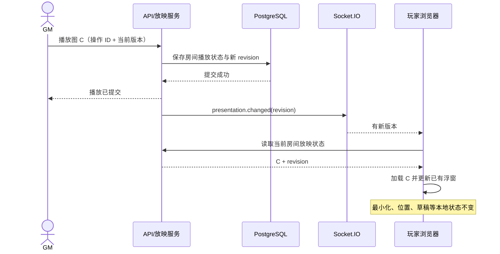

# Project DND（万象跑团）v3.1.1 —— 剧情图片展示系统 / Scene Director

> **Codex 增量开发执行提示词｜轻量可靠版**  
> **适用前提**：Project DND 已依据 v3.0「人工裁决版」完成开发。本文件仅用于在**当前最新仓库**上新增剧情图片展示系统，不重做 v3.0。  
> **典型使用规模**：一名 GM 与约 3–8 名熟人玩家；单台群晖 NAS 或单实例服务器；非面向公共互联网的大规模商业平台。  
> **本次优先级**：**功能可用与不打断操作（P0）→ 图片/状态持久化与断线恢复（P0）→ 导演台与多图编排（P1）→ 大屏、独立放映页和动效（P2）**。  
> **业务核心**：GM 决定展示哪张图片，玩家决定图片窗口如何摆放；玩家在展示期间仍然正常使用人物卡、地图、背包、笔记和掷骰。  
> **明确的资源分配原则**：**不要开展新的大规模数据安全、网络安全或防剧透攻防工程。** 保留现有登录和 GM/玩家角色边界，以及必要的文件格式检查；不要为熟人小房间引入签名 URL 系统、零信任媒体网关、独立审计服务、Redis 集群、S3、CDN、WAF 等额外基础设施。把时间投入可靠性、故障恢复、交互质量和可维护性。

---

## 0. 角色与执行纪律

你是维护现有 Project DND 的全栈工程师、实时协作开发者和 UI/UX 设计师。**直接在当前仓库实现功能，而不是只输出计划、伪代码或静态效果图。**

必须遵循：

1. **先审后改**：以当前最新源码为准。不要假设以前上传的 ZIP 代表现有项目，不覆盖未提交的修改，不推倒重写。
2. **增量开发**：优先复用 React、现有浮窗框架、Express、Socket.IO、Prisma/PostgreSQL、上传模块和当前 Docker Compose。不要为了本模块引入第二套全局状态管理、路由或数据库。
3. **稳定压倒复杂**：一个简单可恢复的版本胜过复杂但容易卡住的媒体中心。没有实测瓶颈，不做分布式化。
4. **完整业务闭环**：GM 上传 → GM 私下预览 → 点击公开放映 → 全员看到 → 切图/黑幕/结束 → 新玩家加入与断线重连恢复。每一环都有真实 API、数据库与 UI 支持。
5. **不中断玩家**：默认非模态图片浮窗。禁止通过重挂载整页、重置地图、强行改路由、抢键盘焦点等方式进行播放。
6. **状态分层**：服务器保存“本房间正在播放什么”；各玩家本地保存“如何观看”。两者绝对不可混为一谈。
7. **不自动裁决战斗**：剧情展示不计算命中、伤害、AP/SP，不改动 Buff、人物属性、战斗、任务状态；保留 v3.0 的人工判定理念。
8. **不虚报测试**：实跑类型检查、构建、测试和联机验收；环境缺数据库、Docker 或 Playwright 时，如实记录“未验证”和重现步骤。
9. **可恢复、可定位**：每个操作有明确的等待/成功/失败反馈；遇到错误能重试、不让页面崩溃、不让图片数据无声消失。
10. **开发阶段可验收**：每完成一个阶段更新 `docs/presentation-implementation-status.md`，注明实现项、验证项、问题与受影响文件。

### 0.1 明确不做的事情

本轮不做自动剧情推进、AI 生成剧情或图片、视频直播、语音会议、完整 PPT 编辑器、自动战斗、像素级防截屏、复杂 DRM、图片版权管理、全站安全整改、企业级审计/告警系统、微服务拆分。

原有 v3.0 安全能力不应被故意削弱，但也**不要求为本功能额外建设一套安全体系**。遇到基础的授权错误或文件处理缺陷，采取局部、低成本修复即可；不要扩大成无边界的安全专项。

---

## 1. 阶段 0：扫描现有项目，确认最小改动范围

优先查看实际存在的文件/等价模块：

```text
package.json / pnpm-workspace.yaml
apps/web/src/pages/App.tsx
apps/web/src/ui/Windows.tsx / Board.tsx
apps/web/src/store.ts / api.ts / style.css
apps/api/src/index.ts / operations.ts / domain.ts
apps/api/prisma/schema.prisma / migrations/
packages/shared/src/
compose.yaml / Dockerfile / nginx.conf
README.md / ARCHITECTURE.md
```

检查并记录：

- v3.0 现有浮窗的拖动、尺寸调整、层级、最小化、恢复机制，能够复用哪些组件。
- Socket.IO 的现有通知方式、断线恢复、快照拉取、写入操作 ID 和版本号方式。
- 图片上传接口、图片存储目录、缩略图处理方式及群晖数据卷映射。
- 现有 GM/玩家权限检查和房间访问方式；沿用即可，不额外设计复杂身份体系。
- 是否已经有通用素材库、图片展示、任务插图功能，避免重复上传和重复建表。
- 最新分支与 Git 工作区状态；不得覆盖未提交代码。

基线验证（按真实 `package.json` 脚本调整）：

```bash
pnpm typecheck
pnpm test
pnpm build
pnpm lint
```

若存在旧错误，先记录；只修复影响新增功能的错误或明确阻断构建的错误，不借机重构全部系统。

**阶段产物**：`docs/presentation-implementation-status.md` 初版，写明仓库基线、复用点、计划修改文件、当前测试状态。

---

## 2. 玩家端展示：默认非模态，不打断操作（P0）

### 2.1 初次放映

GM 在导演台选择某张图片并点击“向全房间展示”后：

1. 当前房间的所有在线玩家收到状态变化，无需刷新网页。
2. 在原游戏界面内出现**尺寸较大的非模态图片浮窗**，不要切换到其他路由，不要挡住全部交互层。
3. 图片保持比例，默认 `contain`，避免裁掉手写线索或重要剧情信息。
4. 窗口可拖动、调整大小、缩小、最小化、恢复、应用内最大化；支持适应窗口、100% 显示、图片局部放大和拖拽平移。
5. 打开图片不夺取正在输入文字的表单焦点；人物卡、地图位置、背包、日志和未保存草稿保持原状。
6. 图片加载慢时先展示占位和进度反馈。加载失败时可以点击重试，但**不得影响整个游戏界面**。

### 2.2 GM 切换图片时

- 所有人最终展示 GM 选定的最新图片。
- 已最小化的玩家仍然保持最小化，只更新“正在展示”入口的内容状态；不会强行弹回窗口。
- 玩家自己移动过的窗口不因切图重新居中，也不重置窗口尺寸和缩放偏好（切换不同尺寸图片时可合理重置图片内部平移以防画面出界）。
- 不会因图片换了而重挂载 App、地图、人物卡或正在输入的文本框。
- 网络中的旧图片请求即使后完成，也不能覆盖已经切换成功的新图。

### 2.3 最小化、关闭和恢复

- GM 的“结束放映”才会改变全房间播放状态。
- 玩家自己的“关闭/最小化/缩小”**只改变本地界面**，不影响其他玩家。
- 顶栏或任务栏保留固定“剧情展示中”入口，点击能打开**当前最新画面**。
- 玩家可以选择暂时忽略本次图片；GM 切图后不反复抢焦点。
- 仅建议本地保存窗口位置和尺寸、是否最小化、用户偏好的模式；不要把这些状态写进数据库作为全房间共享字段。

---

## 3. 三种展示模式

### 模式 A：普通浮窗（默认，P0）

必须完成第 2 节全部交互。该模式适合玩家一边看剧情图片一边查看角色卡、笔记或地图。

### 模式 B：沉浸大屏（P2）

- GM 可以建议使用大屏展示，玩家首次收到时可看到较大的**应用内**图片覆盖层。
- 玩家随时能切回普通浮窗/最小化；一旦切回，GM 后续切图**不得**强制让该玩家重新进入大屏。
- 浏览器原生 Fullscreen API 只能由观看者自己触发，不能承诺 GM 可以远程强制全屏。
- 支持暗幕/黑幕叙事效果，黑幕也可以被玩家本地缩小，不得做成不可解除的锁屏。
- 适配常见 1366×768、1920×1080 和 2560×1440 屏幕，窗口不能跑出视口。

### 模式 C：独立只读观众页（P2，资源允许时实现）

- 在同一 Web 应用中提供 `/rooms/:roomId/presentation` 或项目现有路由风格的观众页。
- 适合 GM 第二显示器、电视、投影仪或 Discord 屏幕共享。
- 只播放当前展示的画面、文字、黑幕；跟随 GM 实时切换，刷新后恢复当前状态。
- 只读，不提供编辑剧情、上传素材或修改人物卡的控制。
- 复用现有账号/房间访问规则，不引入新的公开分享令牌服务或专门放映服务器。

---

## 4. GM 剧情导演台（P1）

### 4.1 剧情图库

GM 可以：

1. 批量或单张上传 JPEG、PNG、WebP 图片；展示进度、上传结果、失败原因，并支持失败重试。
2. 填写标题、玩家可见的说明文字、GM 自己的备注、标签、所属章节。
3. 查看缩略图列表，按章节或名称筛选图片，搜索、重命名和排序。
4. 私下预览一张图片，不通知任何玩家；点击明确的“向房间展示”后才正式放映。
5. 创建章节/分组，支持同一素材在多个演出条目（Cue/Slide）引用，不要求重复上传二进制图片。
6. 随时按任意顺序放映图片，不强制按预设剧本顺序推进。
7. 删除素材或条目时，若它正在放映或被其他条目引用，给出确认和清晰后果；不能让全员界面崩溃。

### 4.2 导演台布局建议

- 左侧：章节树、图片缩略图、搜索。
- 中央：所选图片的大预览、可见字幕预览。
- 右侧：图片标题、描述、备注、转场与显示方式。
- 底部控制条：**预览、放映、上一张、下一张、选择任意图、黑幕、解除黑幕、结束**。
- 当前正在放映的内容需要有清楚状态反馈，避免 GM 不知道图片是否成功展示。
- 键盘快捷键不能拦截其他界面里的文本编辑、公式输入或笔记输入。

### 4.3 图片公开与回看（轻量实现）

只需要简单、可理解的产品规则：

- 新上传图片默认只在 GM 导演台列表中出现，不提前进入玩家图库和房间广播。
- 正式放映后玩家可看到当前图片。
- GM 可以选择：**只在当前放映观看** / **加入已公开线索图库，允许以后回看**。
- 玩家列表只展示已公开且允许回看的图片，不自动列出同章节尚未展示的图片。
- GM 结束放映后，玩家可以根据回看设置再次打开已公开图片。

**安全投入边界**：复用现有 GM/房间权限与媒体访问机制，防止普通操作误把未公开内容列在玩家界面即可。若当前媒体本身是无鉴权静态 URL，记录其剧透局限；能以低成本沿用现有鉴权接口改为受控读取则顺手完成。**不要为防熟人故意抓包、枚举、截图等威胁开发签名链接、复杂授权版本、缓存清退、DRM 或深度渗透测试。**

### 4.4 交互操作表

| GM 操作 | 服务端共享状态 | 玩家端变化 |
|---|---|---|
| 私人预览 | 不变化 | 完全无变化 |
| 放映图片 | 切换为 `showing` | 初次打开普通浮窗/建议大屏 |
| 切换图片 | 图片 ID 与 `revision` 更新 | 显示最新图片，保留本地窗口状态 |
| 黑幕 | `blackout` | 画面变暗，仍可最小化 |
| 解除黑幕 | 返回 `showing` | 恢复当前图片 |
| 结束 | `idle` | 停止当前展示；回看历史依设置保留 |

---

## 5. 多人同步与状态一致性（P0，可靠性的核心）

### 5.1 一房间一份权威放映状态

服务器至少持久化：

- `roomId`
- `status: idle | showing | blackout`
- `activeAssetId` / `activeCueId`（允许为空）
- `requestedMode: floating | cinematic`
- `allowHistory`
- `revision`（单调递增版本）
- `updatedAt` / `updatedBy`

本地窗口状态 `minimized`、`visible`、`x/y`、`width/height`、`zoom`、`pan` 保存在现有前端窗口状态系统中，不能被 GM 切图事件覆盖。

### 5.2 Socket.IO 的职责

- GM 的展示命令先写入数据库，**成功提交后**才广播 `presentation.changed({roomId, revision})`。
- 广播的是**通知**，不是直接通过 Socket 传输图片文件；原图/适屏图通过现有 HTTP 媒体接口加载。
- 客户端收到新版本时读取当前权威状态，或复用现有经过验证的增量同步方式。
- 重复、乱序、迟到的 Socket 事件不得让画面倒退；客户端只采用较新版本。
- 如果 GM 在短时间内连续切图 A→B→C，最终必须显示 C；A、B 的慢速图片请求不能覆盖 C。
- 快速切图避免同时打开十几个无用网络请求；可使用 `AbortController`、限制并发或等效机制。
- 不得通过 `setTimeout` 盲猜网络传输完成；依赖服务端确认和实际加载状态。

### 5.3 断线与刷新恢复

- 玩家刷新页面或断线重连后主动读取 `presentation.current`，恢复该房间当前状态。
- 晚加入的玩家直接看到最新正在公开展示的图片，而不是错过事件后出现空白。
- 如果断线期间 GM 已结束放映，重连后应显示 `idle`，不把缓存旧图当成当前放映。
- Socket 重连与首次加载并发时，以最新 `revision` 为准，避免重复创建浮窗。
- 网络临时中断可显示小型“连接中/点击重试”反馈，但不影响正在编辑的人物卡等其他模块。

### 5.4 同一 GM 重复点击与异常处理

- 复用项目已有操作 ID、事务或版本机制；防止双击“放映/切图”引发同一操作重复保存或跳过图片。
- 两个 GM 控制台同时操作时，使用已有版本冲突机制，最终状态唯一、可解释，不出现永远停留在“加载中”。
- 服务端操作失败时保留上一个成功的当前画面并提示 GM，不得假装成功切换。
- 只有完成保存的有效素材才能进入可放映状态。

### 5.5 时序参考



---

## 6. 数据模型与素材存储（P0，可靠性优先）

以现有 Prisma 模型为准增量开发，不要复制一套已经存在的通用素材表。下面是**领域语义示意**，不是要求照抄字段：

```ts
interface PresentationAsset {
  id: string;
  roomId: string;
  storageId: string;        // 对应实际文件或既有媒体资源
  title: string;
  playerCaption?: string;
  gmNotes?: string;
  groupId?: string;
  createdAt: string;
}

interface PresentationCue {
  id: string;
  roomId: string;
  groupId?: string;
  assetId: string;
  order: number;
  transition: 'none' | 'fade' | 'black_reveal' | 'slow_zoom';
  captionOverride?: string;
}

interface PresentationSession {
  roomId: string;
  status: 'idle' | 'showing' | 'blackout';
  activeAssetId?: string;
  activeCueId?: string;
  requestedMode: 'floating' | 'cinematic';
  allowHistory: boolean;
  revision: number;
  updatedAt: string;
}
```

### 6.1 不丢图片、不产生明显脏数据

这些属于**数据可靠性**，本次必须投入：

1. 素材文件持久保存到群晖的实际挂载卷；不要只写进容器内部临时目录。
2. 路径统一用 Node.js `path.resolve`/等价可靠方式；避免把绝对目录错误拼接进 `process.cwd()`，造成数据卷与实际写入路径不一致。
3. 上传过程中显示进度；只有文件写入成功且数据库元数据保存成功，才向 GM 提示“上传完成”。
4. 上传中断、文件损坏、磁盘不足时返回明确错误，避免数据库保留“有图但找不到文件”的假成功记录；必要时清理孤儿临时文件。
5. 复用现有安全文件名策略，防止同名图片相互覆盖；不要求建设大型媒体安全流水线。
6. 若某图片被多个 Cue 引用，删除其中一个 Cue 不能删除原始图片；删除正在展示的素材时先清晰处理当前播放状态。
7. 用缩略图显示列表，用适屏图播放，用原始图（若已有）供放大；缩略图生成失败不能让整批上传全部卡死，可降级使用原图但提示性能影响。
8. 数据库 Migration 必须向后兼容，不重置现有角色、地图、任务、装备、Buff、公式、骰子和历史记录。

### 6.2 重建容器与恢复

- 升级镜像、重启 API、重建 Web 后，已上传图片和章节信息仍在。
- 数据库中保留的当前放映状态，重启后客户端可以查询并恢复。
- 若某个图片资源真的丢失：界面显示“图片不可用/重试/GM 重新上传”，不能使整个房间页面报错退出。
- 文档提供**简单可执行**的数据库与图片目录备份说明，以及至少一次基本恢复检查方法；不要求建设自动异地容灾系统。

---

## 7. 基础访问与文件处理：维持必要底线，不做安全专项

本节仅用于维持小范围运行的基本可用性，**不得成为主开发任务或阻断非安全功能实施的长期项目**。

最低要求：

1. **复用现有身份体系**：只有 GM 可以上传、管理和放映剧情素材，普通玩家只能观看本房间已公开的内容；禁止引入新的认证方案。
2. **不误剧透**：GM 预览不触发房间广播，玩家素材列表不列出未公开图片；GM 备注不显示在玩家 UI。
3. **基础文件格式检查**：至少支持 JPEG/PNG/WebP，拒绝明显非图片文件、异常文件类型与超出合理体积的图片；不允许把任意 HTML/SVG 当图片执行。
4. **文字按文本渲染**：剧情标题和备注按普通文本展示，不运行用户输入的脚本。
5. **沿用现有媒体接口**：若已经有受控读取则直接用；若无受控读取，优先选择最小变更方案并在文档说明限制，不引入签名 URL 服务器或复杂撤销机制。
6. **不做**：安全审计报表、图像隐写检测、专门渗透测试、复杂访问令牌轮换、逐次权限数据库查询优化、零信任代理、CDN 缓存驱逐、DRM。

不要把“玩家看过图片后不能截图、保存、复制”作为验收目标。图片公开后无法保证收回，这属于正常产品限制。

---

## 8. UI、动效和性能体验（P1/P2）

### 8.1 整体视觉

- 沿用 v3.0 原有暗色主题、边框、阴影、图标、窗口控件与层级，不另造第二套桌面 UI。
- 剧情图片应成为视觉重点。窗口标题、关闭/最小化、字幕等控件清晰但不过分占空间。
- 默认图片不裁切，支持缩放查看信件、纸条、地图线索上的小文字。
- 统一采用可预期的加载态、空态、失败态、重试态和完成反馈。
- 避免长时间 Spinner：上传失败、图片加载失败、Socket 离线都应有明确的结束/重试出口。

### 8.2 转场特效（优先简单、流畅）

| 动效 | 建议时长 | 说明 |
|---|---:|---|
| 立即替换 | 0ms | 默认可选，可靠、直接 |
| 淡入淡出 | 150–350ms | 普通剧情转场 |
| 黑幕揭晓 | 400–900ms | 恐怖、悬念与情绪铺垫 |
| 缓慢推近 | 1.5–4s | 重要 NPC、建筑与线索展示 |

动效仅负责展示，不影响当前公开图片的权威状态。不为动画引入高开销 WebGL 或大型依赖；优先 CSS/Web Animations API。支持禁用动效和 `prefers-reduced-motion`。

### 8.3 3–8 人性能建议

- 避免把原始 20–50 MB 的图片每次都无处理地加载到 8 个客户端；根据现有能力提供缩略图与合理的适屏分辨率。
- 不通过 Socket.IO 推送 base64 图片，只发送状态/引用。
- 图片加载失败局部重试，不需要刷新整房间。
- 图片切换时旧资源释放、事件监听解绑，避免多次放映后页面越来越卡。
- 有性能证据才做更复杂的缓存与分包；**不引入 Redis、S3、CDN 或消息队列**。

---

## 9. 可靠性验收场景（重要性高于安全扫描）

必须覆盖以下业务实际流程。测试可以组合 Vitest、API 集成测试、Playwright 和手工联机验证，但**最终至少要有一次跨多个真实浏览器上下文的流程验证**。

### 9.1 玩家操作不中断

- [ ] 玩家在人物卡文本框输入未保存内容，GM 放映与切换三张图，原文本与输入焦点未丢失。
- [ ] 玩家正在拖动地图、浏览装备、写笔记或使用骰子，GM 放映不会重置这些交互状态。
- [ ] 玩家最小化剧情窗后，GM 连续切图，剧情窗仍保持最小化；恢复时展示最新图片。
- [ ] 玩家自行从沉浸模式切到浮窗，GM 再切图或黑幕，不强行将玩家拉回沉浸模式。
- [ ] 玩家本地关闭剧情窗口不会结束全员放映；“剧情展示中”入口可恢复。
- [ ] 两个玩家各自修改窗口大小、位置、缩放，互不影响。

### 9.2 同步与恢复

- [ ] GM + 至少 2 名玩家在线，GM 一次放映，两名玩家均无需刷新看到图片。
- [ ] GM 快速依次切换 A、B、C，最终所有客户端是 C，不闪回 A 或 B。
- [ ] 玩家断线重连/刷新后恢复 GM 当前放映图。
- [ ] GM 已结束后，离线玩家重连不会误显示正在放映旧图。
- [ ] 第三名玩家晚加入房间直接取得当前展示状态。
- [ ] API/Socket 短暂失败时能提示错误与重试；失败的 GM 切换不显示假成功。
- [ ] GM 重复点击“下一张”不会因网络重试意外跳过多张（按实际命令语义设计去重）。

### 9.3 文件与 NAS 持久化

- [ ] 上传 3 张合法图片后，GM 可创建章节、排序、编辑说明、预览与播放。
- [ ] 单张上传失败时不产生假成功记录，其他已成功素材不会丢失。
- [ ] 删除被多个 Cue 引用的图片时有合理处理，不发生意外删除其他引用。
- [ ] 重启服务或重建相关容器后，素材文件、章节及当前播放状态仍能正确读取。
- [ ] 任一图片文件缺失时，玩家浮窗显示错误占位而不是使地图/人物卡崩溃。
- [ ] 测试 3–8 人加载几张高清图，记录明显卡顿、内存增长或加载失败；有问题再做针对性优化。

### 9.4 基础产品约束（小范围验证即可）

- [ ] GM 私人预览不触发玩家展示。
- [ ] 普通玩家不能通过正常 UI 直接点击“全房间放映”。
- [ ] 说明文字不作为脚本执行；明显非图片文件不能伪装为正常图片展示。
- [ ] 展示和放映不会修改战斗、HP/AP/SP、Buff、技能或公式数据。

### 9.5 运行验证要求

运行现有项目的类型检查、构建、相关单元/集成测试；新增关键业务测试。如仓库已有 Playwright，优先新增真实 1 GM + 2 玩家 E2E；如没有 Playwright，可引入它进行最小联机验收，但不要为完整覆盖率陷入测试框架大改造。无自动化环境时提供可实际操作的手工验收记录和脚本。

---

## 10. 实施顺序与每阶段交付

### 阶段 A（P0）：最小可用闭环

- 复用现有上传与媒体目录，增加剧情图片素材及当前展示状态的最小数据结构。
- 完成 GM 上传、私下预览、一键放映、切图、结束。
- 所有在线玩家显示非模态浮窗，可最小化、恢复，且不影响其他交互。
- 完成 Socket 同步和新玩家加入时读取当前状态。

**验收**：1 GM + 2 玩家实际联机完成「上传 → 放映 → 切换 → 结束」，人物卡草稿不丢，浮窗不抢焦点。

### 阶段 B（P0）：稳定性与数据可靠性

- 完成图片保存、数据库关联、数据卷映射、容器重启恢复。
- 完成断线/刷新恢复、版本去重、快速切图旧请求隔离、文件加载重试、失败提示。
- 完成基础上传异常处理和必要的回滚/临时文件清理。

**验收**：断线、上传失败、连续切图、容器重建等场景可恢复；不会误报成功、丢图或让整个游戏界面崩溃。

### 阶段 C（P1）：GM 导演台与剧情编排

- 章节分组、排序、批量上传、Cue、图片字幕、GM 私人备注、搜索和任意跳转。
- 公开后是否加入线索图库的简单选项。
- 有清晰的当前播放状态、删除引用确认和上传状态。

**验收**：GM 可以提前准备 5 张图，在跑团中不重新上传就能任意顺序展示；普通玩家的图库只列出已公开项。

### 阶段 D（P2）：大屏、独立观众页、动效

- 沉浸式大屏但可本地退出；黑幕；四种轻量转场；减少动画。
- 根据现有路由与开发成本，完成独立只读观众页。

**验收**：玩家随时缩回浮窗；大屏和动效不影响地图/人物卡操作；第二显示器能跟随 GM 放映。

### 阶段 E（P2）：体验收尾与交付

- 性能实测、图片适屏策略、错误提示完善、简单 NAS 备份/恢复指引。
- 更新 README、架构说明、实际测试报告与剩余问题。
- 如有明显代码臃肿，可对新增模块进行局部组件拆分，不为新增功能重构全部 `operations.ts` 或 `Windows.tsx`。

**验收**：3–8 人熟人房间具备可复现的可用性测试记录，所有未完成项明确列出。

> **上下文/时间不足时的收敛要求**：优先完成阶段 A + B，不允许把大量时间用于安全加固、漂亮但无功能的控制台或不必要的后端重构。

---

## 11. 推荐模块边界（仅供参考，实际以仓库结构为准）

```text
apps/api/src/
  presentation/
    service.ts          # GM 播放、切换、停止；权威状态与版本
    assets.ts           # 复用上传目录、素材关联、加载/错误处理
    routes.ts           # 接入现有房间 API 和操作入口

apps/web/src/
  ui/presentation/
    DirectorConsole.tsx  # GM 导演台
    PresentationViewer.tsx # 玩家图片浮窗
    PresentationStage.tsx  # 大屏与独立观众页（P2）
  hooks/
    usePresentation.ts  # 放映状态、Socket 通知、断线恢复

apps/api/prisma/
  schema.prisma
  migrations/

docs/
  presentation-module.md
  presentation-implementation-status.md
```

不强制新增这些文件；如果项目已有成熟模块，将本功能嵌入现有模块也可以。**避免为新功能建立一套平行的账号系统、素材库、Socket 基础设施或窗口系统。**

---

## 12. 最终验收清单（按实际结果勾选）

### 必须完成（P0）

- [ ] GM 能上传、预览、放映、切换、结束剧情图片。
- [ ] 所有在线玩家同步展示，默认浮窗不锁住原操作界面。
- [ ] 已最小化窗口不会被 GM 切图重新弹出。
- [ ] 人物卡草稿、地图交互、背包和笔记不会因剧情变化被重置。
- [ ] GM 放映状态由服务器保存，刷新、晚加入、断线重连可恢复。
- [ ] 快速切图、旧网络请求、重复 Socket 事件不会造成画面回退。
- [ ] 上传成功的图片保存到持久卷，容器重启后仍在。
- [ ] 上传/图片加载/服务端切换失败有清晰提示与重试，不使整个游戏崩溃。
- [ ] 现有 v3.0 公式、Buff、装备、骰子、人工战斗与 AP/SP 不受影响。
- [ ] 至少通过一次真实的 1 GM + 2 玩家跨浏览器联机验收。

### 体验增强（P1/P2）

- [ ] 剧情图库、章节、Cue、搜索、排序和图片说明可用。
- [ ] 可选择公开后回看或仅当次展示。
- [ ] 支持沉浸式大屏、黑幕和自由缩回浮窗。
- [ ] 支持独立只读观众页（若已实施，必须标明）。
- [ ] 转场简洁流畅、可禁用，支持减少动画。
- [ ] 3–8 人高清图片基本性能已验证。
- [ ] NAS 部署、重启、简单备份与恢复说明齐全。

### 开发不得偏离

- [ ] 没有引入额外认证服务、复杂签名链接、Redis/S3/CDN/WAF、企业安全扫描平台。
- [ ] 没有重写现有项目架构、清空数据库或覆盖用户已完成的 v3.0 功能。
- [ ] 没有将本模块与自动战斗、属性自动裁决、技能触发系统耦合。
- [ ] 所有标记“已验证”的项目都有对应测试输出或手工验收步骤。

---

## 13. 给 Codex 的最终执行命令

**现在开始修改当前项目源码，不要停留在计划阶段。**

执行顺序：

1. 读取最新仓库，识别 v3.0 现有能力和可以复用的上传、浮窗、Socket、数据库与 Docker 模块。
2. 记录基线测试结果，保护现有修改和数据库，不因本需求而大规模重构。
3. **优先实现阶段 A：GM 上传/预览/放映 → 多个玩家同步收到非模态浮窗 → 切换/结束。**
4. 继续实现阶段 B：确保断线恢复、快速切图不乱序、上传失败有提示、图片与当前展示状态能持久化、重启后可恢复。
5. 其后完成 GM 剧情编排，再加沉浸大屏、独立观众页与动效。
6. **不要开展大规模数据安全或网络安全建设**；仅沿用现有账号/房间角色、基础文件校验和不误公开素材的产品逻辑，不以安全专项拖延主要功能。
7. 每阶段运行可用的类型检查、测试和构建，并以真实 GM + 多玩家流程验证。没有环境的项目记为“未验证”，不要虚构测试通过。
8. 更新 `docs/presentation-implementation-status.md`、README 与必要的架构文档，输出实际修改文件、迁移命令、启动步骤、真实通过的测试和遗留问题。

**最终目标**：为已完成的 Project DND v3.0 添加一套适合熟人跑团的、轻量但可靠的「剧情导演台」。GM 事先准备多张图片并按剧情同步放映；所有玩家默认通过不打断操作的浮窗观看，可自行放大、最小化和恢复；GM 能切图、黑幕和结束；支持断线恢复、NAS 持久化和可选大屏。整个开发以**稳定、易用、少依赖、可维护**为原则，不把重点转向无关的安全工程。
